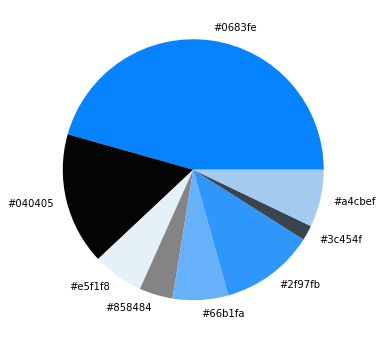

> Give it any image, and it returns the main colors with their hex codes and share of the image.

**Training project · IoT & Computer Vision track**  
**Tools:** Python, OpenCV, scikit-learn, Matplotlib

## The challenge

Designers and analysts often need a picture's main colors as exact values, without picking them by hand.

## The data

Any image. No training data is needed, since the method learns from the image's own pixels.

## How it works

1. Prepared the image pixels as data points.
2. Grouped them into 8 colors with K-Means.
3. Counted each group and drew a chart labelled with hex codes.

## A closer look

- **Preparation:** the image is converted to RGB, and its pixels are treated as points in color space.
- **Clustering:** K-Means groups them into 8 colors.
- **Output:** the size of each group gives the share of each color, shown as a labelled chart.

## Key decisions

- Clustering finds colors from the image itself, with no fixed color list.

## Results

| Measure | Result |
|---|---|
| Colors extracted | **8** |
| Output | **Hex codes and shares** |

## Visual results

*The main colors of a test image, with hex codes*

## Programming skills

- Python programming and reusable functions
- Image processing with OpenCV
- Pixel data handling with NumPy
- K-Means clustering with scikit-learn
- Converting color values to hex codes
- Data visualization

## Good to know

- The number of colors is chosen in advance.

## What I would do next

- Choose the number of colors automatically.

<strong>بالعربي: تحديد ألوان الصور</strong>

يستخرج الألوان الرئيسية لأي صورة بخوارزمية K-Means، مع رمز كل لون ونسبته.

**ملاحظة:** عدد الألوان يُحدد مسبقًا.

**المهارات البرمجية:** Python programming and reusable functions، Image processing with OpenCV، Pixel data handling with NumPy، K-Means clustering with scikit-learn، Converting color values to hex codes، Data visualization.

الكود خاص، وهذه الصفحة تعرض فكرة المشروع وطريقة عمله ونتائجه.

---

**About the source code:** the code for this project is private. This page presents what it does, how it works, and its results. To talk about the work, contact me through my [GitHub profile](https://github.com/SamerAlTaki97).
